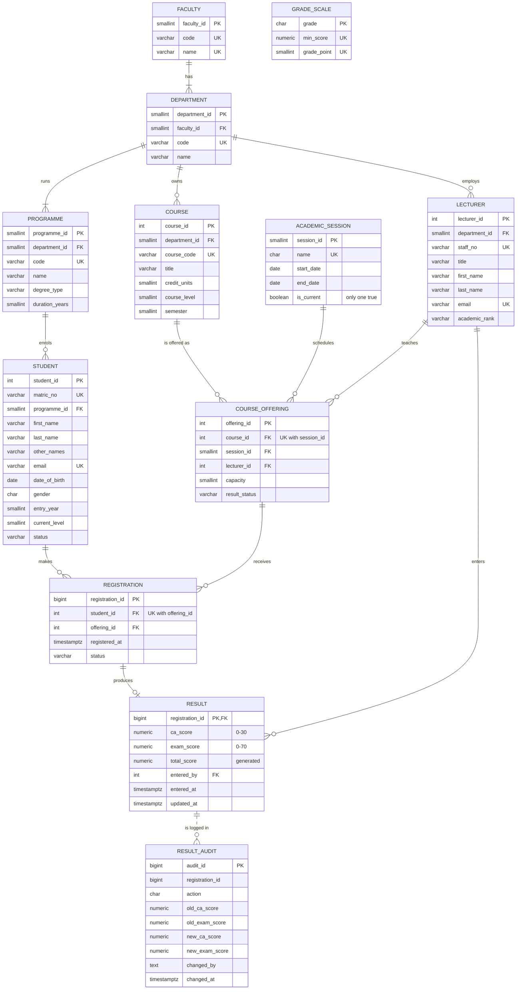

# ER Diagram: Crestfield University Student Result Portal

GitHub renders this diagram automatically. A PNG of it is in
[`evidence/p1-02-er-diagram.png`](evidence/p1-02-er-diagram.png), rendered from
the code block below with Mermaid 11.4. Pasting the block into https://mermaid.live
and exporting it produces the same diagram.

## How to read the diagram

| Relationship | Cardinality | Meaning |
|---|---|---|
| Faculty to Department | 1 : 1..N | Every faculty has at least one department; every department belongs to exactly one faculty. |
| Department to Programme | 1 : 1..N | A department runs one or more degree programmes. |
| Department to Lecturer / Course | 1 : 0..N | Lecturers and courses belong to one home department. |
| Programme to Student | 1 : 0..N | A student is admitted into exactly one programme. |
| Course and Session to Course_Offering | 1 : 0..N each | **Course_Offering** turns the M:N between Course and Session into two 1:N relationships. It records that a course ran in a given session, taught by a given lecturer. |
| Student and Course_Offering to Registration | 1 : 0..N each | **Registration** resolves the M:N between Student and Course_Offering. |
| Registration to Result | 1 : 0..1 | A registration has at most one result, and it has none until scores are entered. `result` uses `registration_id` as both its PK and FK. |
| Result to Result_Audit | 1 : 0..N (dotted line) | Logical link only, with no FK, so audit history survives if a result is deleted. |
| Grade_Scale | (not linked) | A policy lookup table, matched by score range (`min_score <= total_score`) rather than by a foreign key. |
