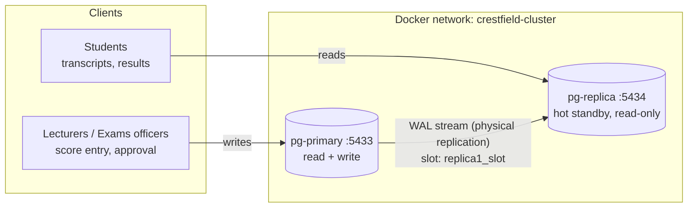

# Portfolio 5: Distributed and Cloud Database Exercise

**Case study:** Crestfield University Student Result Portal
**Engine:** PostgreSQL 16.4 streaming replication (1 primary + 1 hot standby) in Docker Compose

## 1. Why the portal needs a distributed setup

| Requirement | Cause | Mechanism used |
|---|---|---|
| **Availability** | Results release day and registration week: if the database server fails, 60,000 students can't register or see results | Hot-standby **replica** with **failover** (promotion) |
| **Read scalability** | About 95% of traffic is reads (transcripts, result checks). Writes come from a few hundred lecturers and officers | **Read replicas** take the read traffic; the primary handles writes |
| **Data growth** | Results accumulate every year and old sessions are rarely queried | **Range partitioning** by year, with archiving by DETACH |
| **Future scale-out** | Several campuses or a national platform | **Hash partitioning / sharding** by `student_id` |

## 2. Architecture



### How it works

1. **WAL (write-ahead log).** Every change on the primary is first written to the WAL. `wal_level=replica` makes the WAL detailed enough to rebuild the database on another server.
2. **Base backup.** On its first start the replica runs `pg_basebackup` ([`scripts/replica-entrypoint.sh`](scripts/replica-entrypoint.sh)), which copies the whole primary data directory. `--write-recovery-conf` creates `standby.signal` and stores `primary_conninfo`.
3. **Streaming.** The replica's *WAL receiver* connects to the primary's *WAL sender* and replays changes continuously. With `hot_standby=on` it answers read-only queries while replaying.
4. **Replication slot** (`replica1_slot`, created in [`config/00_replication.sh`](config/00_replication.sh)). The primary keeps WAL until the replica confirms it has received it. If the replica is offline for a while, it can still catch up. The risk is that WAL builds up on the primary's disk if the replica never returns, so the slot must be monitored.
5. **Security.** A dedicated `replicator` role has only the `REPLICATION` privilege and authenticates with SCRAM-SHA-256 ([`config/pg_hba.conf`](config/pg_hba.conf)).

### Configuration summary

| Setting | Value | Purpose |
|---|---|---|
| `wal_level` | replica | Enough WAL detail for physical replication |
| `max_wal_senders` | 10 | Maximum concurrent replica / backup connections |
| `max_replication_slots` | 10 | Slots available |
| `wal_keep_size` | 256MB | Extra WAL retained as a safety margin |
| `hot_standby` | on | The replica serves read-only queries |
| `synchronous_standby_names` | `''` (async) by default; `'*'` in demo 6 | Switches between asynchronous and synchronous commit |

## 3. Partitioning and sharding strategy ([`sql/01_partitioning.sql`](sql/01_partitioning.sql))

### A. Range partitioning: `result_history` by academic year

- One partition per year (2023–2026), one for 2019–2022, and a DEFAULT partition. 400,000 rows in total.
- **Partition pruning.** `WHERE session_year = 2024` scans only `result_history_2024` (shown with EXPLAIN). Queries for one session, which most result queries are, read about 1/5 of the data.
- **Archiving.** `DETACH PARTITION result_history_2019_2022` removes 4 years of data from the live table instantly, with no large DELETE, no table bloat and no VACUUM afterwards. The detached table can be moved to cheaper storage or dumped.
- **Rule:** the primary key must include the partition key, so it is `PRIMARY KEY (session_year, matric_no, course_code)`.

### B. Hash partitioning: `activity_log` by `student_id` (shard simulation)

- 4 hash partitions, `MODULUS 4`. 200,000 events spread at about 25% per shard (the script prints the distribution).
- A single-student query is routed to **one** shard. A query without the shard key has to visit **all** shards.
- This is the same mechanism a distributed PostgreSQL such as **Citus** uses, where each "partition" lives on a different worker node.

### Sharding design for a multi-node deployment (not executed; this is the design)

```sql
-- On a Citus coordinator (design):
SELECT create_distributed_table('student',      'student_id');
SELECT create_distributed_table('registration', 'student_id', colocate_with => 'student');
SELECT create_distributed_table('result',       'student_id', colocate_with => 'student'); -- would need student_id added
SELECT create_reference_table('course');            -- small, copied to every node
SELECT create_reference_table('grade_scale');
SELECT create_reference_table('academic_session');
```

| Decision | Reason |
|---|---|
| **Shard key = `student_id`** | Almost every hot query is per student (transcript, registration, GPA). Co-locating a student's registrations and results on the same node makes those queries **single-shard**, with no network joins. High cardinality (60k+) gives an even spread. |
| **Not `session_id`** | Only about 8 distinct values. The current session would be a **hot shard** taking all the writes in registration week. |
| **Not `offering_id`** | A student's transcript would be spread over many shards, so every transcript would need a cross-shard query. |
| **Reference tables** for course, grade_scale, session | They're small and joined everywhere, so a full copy on each node avoids cross-node joins. |
| **Trade-off** | Course-level reports (pass rate per course, Portfolio 2 Q3) become **multi-shard** queries. They're fine as background reports, run in parallel on all nodes. |

## 4. Consistency, availability and the CAP / PACELC trade-offs

**CAP:** during a network **P**artition, a distributed system must choose between **C**onsistency (every read sees the latest write) and **A**vailability (every request gets an answer).

**PACELC** adds: **E**lse, in normal operation, the choice is between **L**atency and **C**onsistency.

The run script demonstrates both modes on the same cluster:

| Mode | Demo | Normal operation (ELC) | Replica unreachable (PAC) | Classification |
|---|---|---|---|---|
| **Asynchronous** (default) | 3, 6c | Commit returns as soon as the primary has written its WAL, so **low latency**. A read on the replica *may* briefly miss the latest write (replication lag, typically milliseconds). | Writes **continue** (6c). The replica catches up later from the slot (6d). | **PA/EL**: availability and latency first, **eventual consistency** on replicas |
| **Synchronous** (`synchronous_standby_names='*'`) | 6a, 6b | Commit waits for the replica's acknowledgement, so **higher latency**. No committed transaction can be lost in a failover. | Commits **block** (6b). After `statement_timeout`, PostgreSQL warns *"canceling wait for synchronous replication… The transaction has already committed locally, but might not have been replicated"*. | **PC/EC**: consistency and durability first |

### My choice for the portal

- **Score entry and approval (the primary database): synchronous replication in production,** with *two* standbys (`synchronous_standby_names = 'ANY 1 (replica1, replica2)'`). An approved result must never be lost in a failover (**RPO = 0**). With 2 standbys, losing one doesn't block commits, which avoids the 6b problem.
- **Transcript and result reads: served from asynchronous read replicas.** A student seeing a result a few milliseconds late is harmless, and approved results don't change afterwards anyway.
- **Read-your-own-writes.** After a lecturer saves scores, the application reads that lecturer's own data from the *primary* for the rest of the session, so they never see their own change "disappear".

### Availability: failover (demo 7)

1. The primary is stopped (simulated server failure).
2. `SELECT pg_promote()` on the replica ends recovery mode. `pg_is_in_recovery()` becomes `false`, and the old replica accepts writes. The run script measures how long promotion takes.
3. With async replication, any transactions not yet replicated at the moment of failure are lost (**RPO > 0**). With sync replication, none are.
4. In production, promotion is automatic. **Patroni** (with etcd) or a managed cloud service detects the failure, promotes the best replica, and moves the client endpoint. The old primary must be rebuilt with `pg_rewind` or a new base backup before it can rejoin as a replica.

## 5. Cloud deployment design

The same architecture maps directly onto a managed cloud database:

| Component | Docker (this exercise) | Azure | AWS |
|---|---|---|---|
| Primary | `pg-primary` container | Azure Database for PostgreSQL – Flexible Server (General Purpose, D4ds_v5) | Amazon RDS for PostgreSQL (db.m6g.large) |
| Synchronous standby (HA) | `synchronous_standby_names` | **Zone-redundant HA**: a synchronous standby in another availability zone, with automatic failover | **Multi-AZ** deployment |
| Read replicas | `pg-replica` | Read replicas (async), optionally in another region | RDS read replicas |
| Failover | `pg_promote()` | Automatic; the DNS endpoint is unchanged | Automatic; the endpoint is unchanged |
| Backups | (not configured) | Automatic, point-in-time restore up to 35 days | Automated snapshots + PITR |
| Documents (Portfolio 4) | `mongo` container | Azure Cosmos DB for MongoDB (vCore) | Amazon DocumentDB / MongoDB Atlas |
| Network security | Docker network + `pg_hba.conf` | Private endpoint (VNet), no public IP, Entra ID authentication | VPC security groups, IAM auth |

Example provisioning (Azure CLI, for illustration; **not run** because it creates paid resources):

```bash
az postgres flexible-server create --resource-group crestfield-rg --name crestfield-results \
  --location southafricanorth --version 16 --tier GeneralPurpose --sku-name Standard_D4ds_v5 \
  --high-availability ZoneRedundant --storage-size 128 --backup-retention 35
az postgres flexible-server replica create --resource-group crestfield-rg \
  --replica-name crestfield-results-read1 --source-server crestfield-results
```

**Why managed in production:** the university's ICT unit then doesn't have to run Patroni, backups, OS patching or monitoring itself. The trade-off is cost and less control over configuration (for example, no superuser access).

## 6. How to run and verify

```powershell
.\portfolio-5-distributed-cloud\run.ps1        # about 1-2 minutes; recreates the cluster each time
```

| Step | Verification | Expected result |
|---|---|---|
| 1 | Containers healthy, `pg_stat_replication` has 1 row | `state = streaming` |
| 2 | Primary `pg_stat_replication`, replica `pg_stat_wal_receiver` | `sync_state = async`; replica `status = streaming`, `is_standby = t` |
| 3 | INSERT on primary, SELECT on replica | Row visible on the replica within milliseconds; `replay_lag` close to 0 |
| 4 | INSERT on replica | `ERROR: cannot execute INSERT in a read-only transaction` |
| 5 | Partition counts on the replica | Same as on the primary (DDL and data are replicated) |
| 6a–d | Sync on, then replica down, then async, then replica back | `sync_state = sync`; a blocked commit with a WARNING; an instant async commit; all heartbeat rows present on the replica after restart |
| 7 | Stop primary, promote replica | `promoted = t`, `is_standby = f`, the INSERT succeeds |

Manual inspection:

```powershell
docker exec -it crestfield-pg-primary psql -U portal_admin -d result_portal    # primary
docker exec -it crestfield-pg-replica psql -U portal_admin -d result_portal    # replica
docker compose -f portfolio-5-distributed-cloud\docker-compose.replication.yml down -v   # reset
```

## 7. Evidence (`evidence/` folder)

| File | What it shows |
|---|---|
| `p5-01-cluster-up.png` | `docker ps` with `crestfield-pg-primary` and `crestfield-pg-replica` both `(healthy)` |
| `p5-02-replication-status.png` | Sections 2a/2b of `results/replication_report.txt`: `streaming`, slot active, `is_standby = t` |
| `p5-03-write-read.png` | Section 3 (row visible on the replica in N ms) and section 4 (read-only error) |
| `p5-04-partition-pruning.png` | `results/partitioning.txt`: the EXPLAIN showing only `result_history_2024` scanned, plus the shard distribution table |
| `p5-05-sync-vs-async.png` | Sections 6a–6d: `sync_state = sync`, the WARNING after 5 s, the instant async commit, the replica catching up |
| `p5-06-failover.png` | Section 7: `promoted = t`, `is_standby = f`, the write on the new primary |
